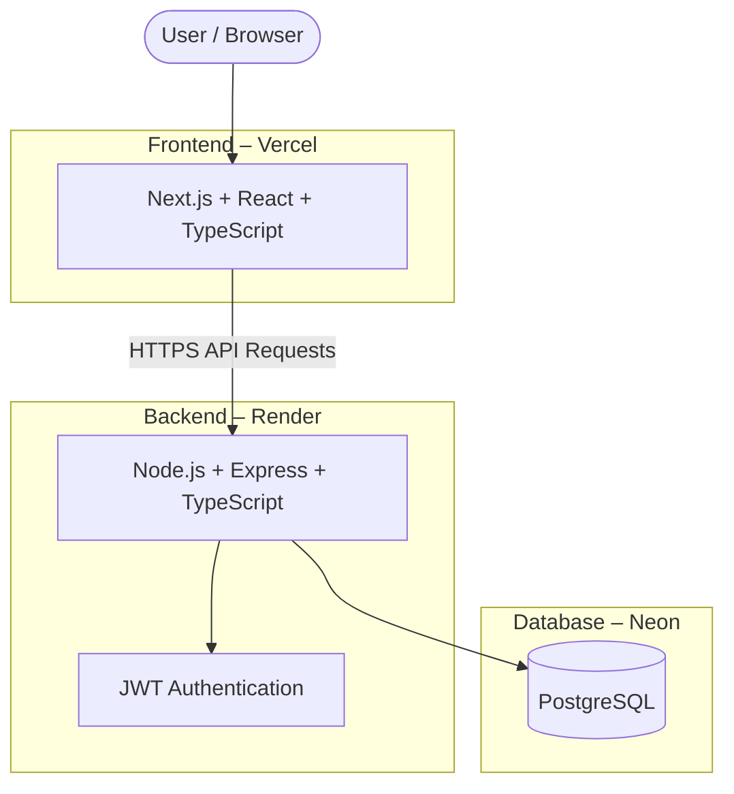
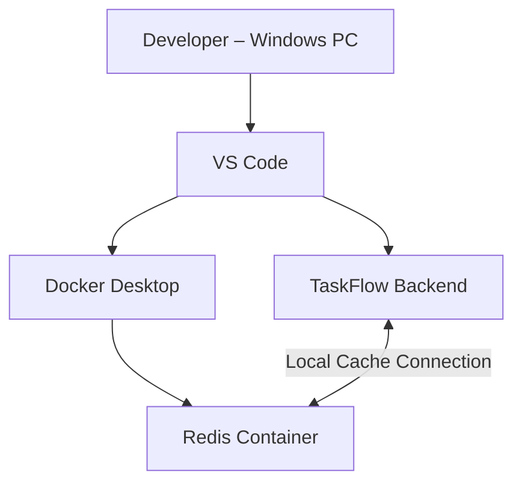

# TaskFlow – System Architecture

## Production Architecture

## Local Development Environment

## Technology Stack

- Frontend: Next.js, React, TypeScript, Tailwind CSS
- Backend: Node.js, Express, TypeScript
- Database: PostgreSQL (Neon)
- Caching: Redis
- Authentication: JWT
- Frontend Hosting: Vercel
- Backend Hosting: Render
- Local Containerization: Docker Desktop
- API Documentation: Swagger
