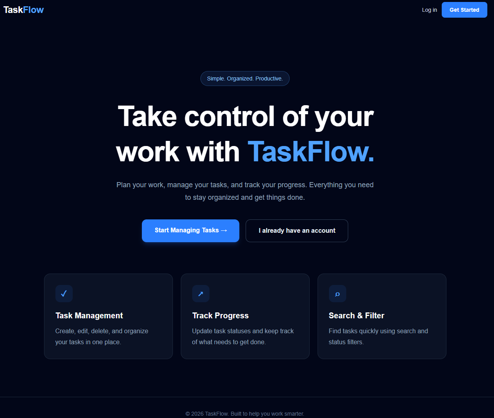

# TaskFlow – Frontend

TaskFlow is a task management application built with Next.js, React, TypeScript, and Tailwind CSS. It allows users to register, log in, and manage their personal tasks through a responsive dashboard. TaskFlow helps users organize tasks, track progress, and manage their daily work.

## Live Demo

**Application:** https://taskflow-satyobroto.vercel.app

**API Documentation:** https://taskflow-api-c3hg.onrender.com/api-docs/

## Screenshots

<table>
  <tr>
    <td align="center">
      <strong>Homepage</strong><br/>
      
    </td>
  </tr>
</table>

## Features

- User registration and login
- JWT-based authentication
- Create tasks with titles and descriptions
- View and manage tasks
- Edit and delete tasks
- Update task status
- Search tasks by title or description
- Filter tasks by status
- Responsive user interface

## Tech Stack

- Next.js
- React
- TypeScript
- Tailwind CSS
- REST API
- JWT Authentication

## Project Structure

```text
frontend/
├── src/
│   ├── app/
│   │   ├── login/
│   │   ├── register/
│   │   ├── dashboard/
│   │   └── page.tsx
│   └── lib/
│       └── api.ts
├── public/
├── .env.local
├── package.json
└── README.md
```

## Getting Started

### 1. Install dependencies

```bash
npm install
```

### 2. Configure environment variables

Create a `.env.local` file in the frontend root directory:

```env
NEXT_PUBLIC_API_URL=https://taskflow-api-c3hg.onrender.com
```

This variable specifies the backend API URL.

### 3. Start the development server

```bash
npm run dev
```

Open [http://localhost:3000](http://localhost:3000) in your browser.

## Backend

The frontend communicates with the TaskFlow REST API.

- **Production API:** https://taskflow-api-c3hg.onrender.com
- **API Documentation:** https://taskflow-api-c3hg.onrender.com/api-docs/
- **Health Check:** https://taskflow-api-c3hg.onrender.com/health

## Authentication

TaskFlow uses JWT-based authentication. After successful login, the authentication token is stored in the browser's session storage and used for authenticated API requests.

## Features

- User registration and login
- JWT-based authentication
- Task creation, editing, and deletion
- Task status management
- Search and filter tasks
- User-specific task ownership
- Input validation and error handling
- Responsive user interface
- Redis caching
- API documentation with Swagger

## Technology Stack

### Frontend
- Next.js
- React
- TypeScript
- Tailwind CSS

### Backend
- Node.js
- Express.js
- TypeScript
- Prisma ORM
- JWT Authentication

### Database and Infrastructure
- PostgreSQL (Neon)
- Redis
- Docker Desktop (local development)

### Deployment
- Frontend: Vercel
- Backend: Render

## Architecture

See [ARCHITECTURE.md](./ARCHITECTURE.md) for the production architecture and local development environment diagrams.

## Local Development

### 1. Clone the repository

```bash
git clone https://github.com/broto1234/taskflow-frontend.git
cd taskflow-frontend
```

### 2. Install dependencies

```bash
npm install
```

### 3. Configure environment variables

Create a `.env.local` file:

```env
NEXT_PUBLIC_API_URL=http://localhost:5000
```

For production, configure the deployed backend URL instead.

### 4. Start the development server

```bash
npm run dev
```

Open http://localhost:3000 in your browser.

**Note:** The backend API must also be running for authentication and task management to work locally. See the [backend repository](https://github.com/broto1234/taskflow-api).

## Related Repository

[TaskFlow Backend API](https://github.com/broto1234/taskflow-api)

## Author

**Satyobroto Talukder**  
Full-Stack Developer